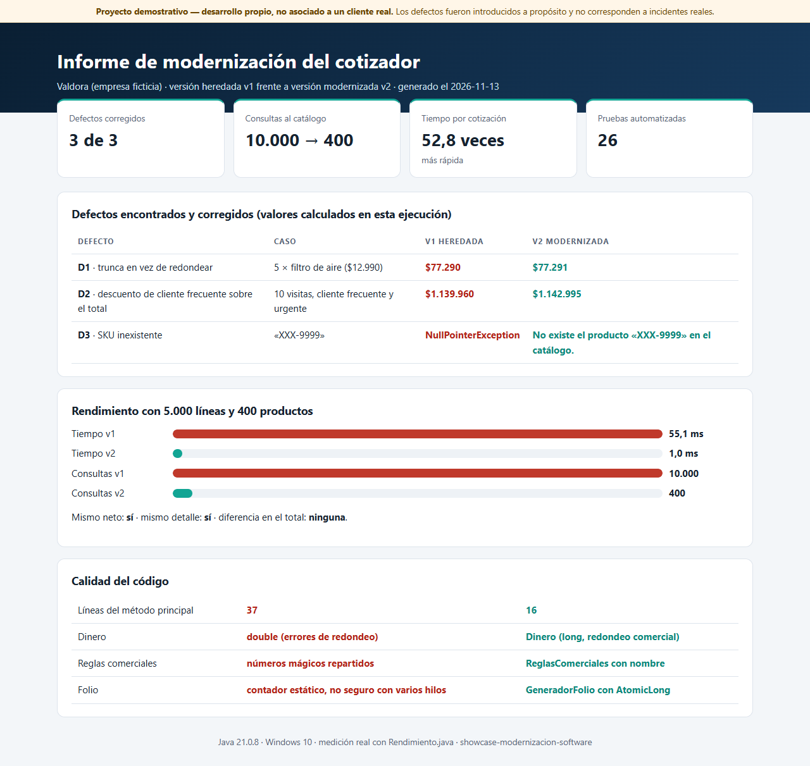
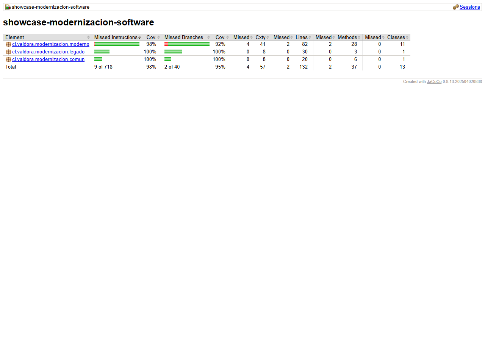
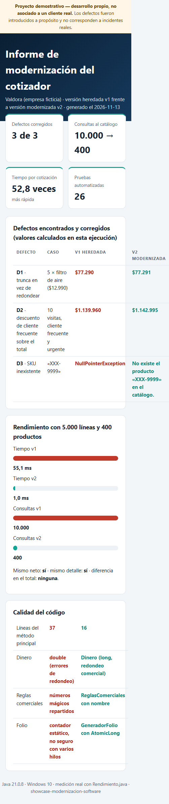

# Mantenimiento y modernización de software · cotizador Valdora

> **Proyecto demostrativo — desarrollo propio, no asociado a un cliente real.**
> «Valdora» es una empresa ficticia. El sistema heredado se escribió **a propósito** con defectos y malas prácticas para mostrar el proceso. Los defectos son controlados y **no corresponden a incidentes reales**.



## Qué problema resuelve

Muchas empresas tienen sistemas que «funcionan», pero nadie se atreve a tocar: cálculos con errores de redondeo, reglas escondidas en números mágicos, métodos enormes y lentitud con volúmenes grandes. Este proyecto muestra **cómo recibo un sistema así y lo mejoro sin romperlo**:

1. **Diagnóstico** con evidencia ([`docs/01-diagnostico.md`](docs/01-diagnostico.md)).
2. **Pruebas de caracterización** que fijan el comportamiento actual antes de cambiar nada.
3. **Refactorización** por pasos, con el código antes y después ([`docs/02-antes-despues.md`](docs/02-antes-despues.md)).
4. **Corrección de defectos**, cada uno con su prueba.
5. **Mejora de rendimiento justificada** y medida ([`docs/04-rendimiento.md`](docs/04-rendimiento.md)).
6. **Registro de cambios** ([`CHANGELOG.md`](CHANGELOG.md)).

## Resultados (medidos en una ejecución real)

| Indicador | v1 heredada | v2 modernizada |
|---|---|---|
| D1 · 5 filtros de aire | $77.290 (trunca) | **$77.291** |
| D2 · 10 visitas, cliente frecuente y urgente | $1.139.960 | **$1.142.995** |
| D3 · SKU inexistente | `NullPointerException` | **Mensaje claro con el SKU** |
| Consultas al catálogo (5.000 líneas) | 10.000 | **400** (−96 %) |
| Tiempo por cotización (5.000 líneas) | 55,1 ms | **1,0 ms** (52,8 veces más rápida) |
| Líneas del método principal | 37 | **16** |
| Equivalencia (500 cotizaciones aleatorias) | — | Mismo neto y mismo detalle; total igual o 1 peso arriba por D1 |

Los tiempos dependen de la máquina: se midieron con Java 21 en Windows 10 y se pueden reproducir con `Rendimiento`.

## Estructura

```mermaid
flowchart LR
  subgraph Antes["v1 · legado/"]
    L[CotizadorLegado.cotizar<br/>todo en un método,<br/>double y String[]]
  end
  subgraph Despues["v2 · moderno/"]
    S[ServicioCotizacion] --> M[Modelo<br/>records validados]
    S --> D[Dinero<br/>redondeo comercial]
    S --> R[ReglasComerciales]
    S --> F[FormatoDetalle]
    S --> G[GeneradorFolio]
  end
  L -. mismo catálogo .-> C[(CatalogoPrecios)]
  S --> C
  S --> A[(RegistroAuditoria)]
```

```text
src/main/java/cl/valdora/modernizacion/
├── legado/        Versión heredada v1, sin cambios, para comparar
├── moderno/       Versión modernizada v2
├── comun/         Puertos compartidos: catálogo y auditoría
└── herramientas/  Rendimiento: medición y generación del informe
```

## Cómo ejecutarlo

Requisito: JDK 21. El proyecto incluye el wrapper de Maven.

```bash
./mvnw verify                                                          # pruebas y cobertura
java -cp target/classes cl.valdora.modernizacion.herramientas.Rendimiento docs 26   # medición e informe
python scripts/capturas.py                                             # capturas (opcional, requiere Playwright)
```

## Pruebas

**Resultado verificado: 26 pruebas, 26 aprobadas** (13-11-2026, JDK 21). Cobertura JaCoCo: **98,5 % de líneas** y **95,0 % de ramas**. La herramienta de medición `herramientas/` queda fuera de la cobertura.

| Clase | Pruebas | Qué demuestra |
|---|---|---|
| `CotizadorLegadoCaracterizacionTest` | 7 | Comportamiento actual de la v1, con los defectos D1, D2 y D3 documentados |
| `ServicioCotizacionTest` | 12 | Cálculos de la v2, defectos corregidos, tramos de descuento. **Mockito** verifica una consulta por SKU y la auditoría |
| `ValidacionesTest` | 5 | Validaciones, `Dinero` y folios únicos con 8 hilos |
| `EquivalenciaTest` | 2 | 500 cotizaciones aleatorias equivalentes y 50 veces menos consultas al catálogo |

| Cobertura (JaCoCo) | Informe en móvil |
|---|---|
|  |  |

## Cómo aplico esto en un sistema real

- Empiezo siempre por pruebas que fijen el comportamiento actual, incluso el defectuoso, y acuerdo con el cliente qué defectos se corrigen.
- Hago cambios pequeños y verificables, y mido antes y después de optimizar.
- Entrego un diagnóstico, un plan priorizado, un registro de cambios y las pruebas que dejan protegido el sistema.

## Licencia y autor

Licencia MIT. Diseño y desarrollo: **Pablo Ortega Rubio** — desarrollo de software, automatización e integraciones · [github.com/PabloOrtegaRB](https://github.com/PabloOrtegaRB)
